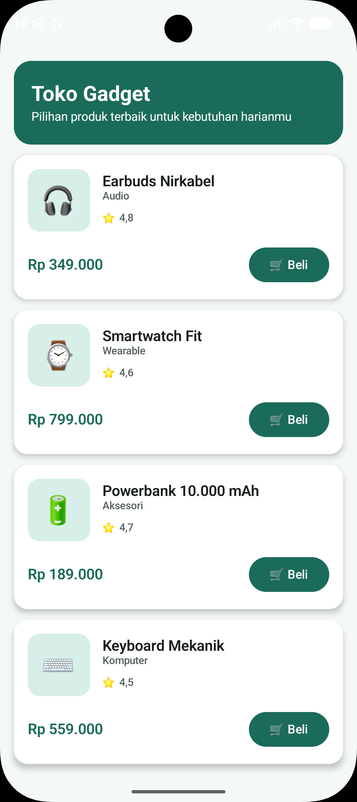
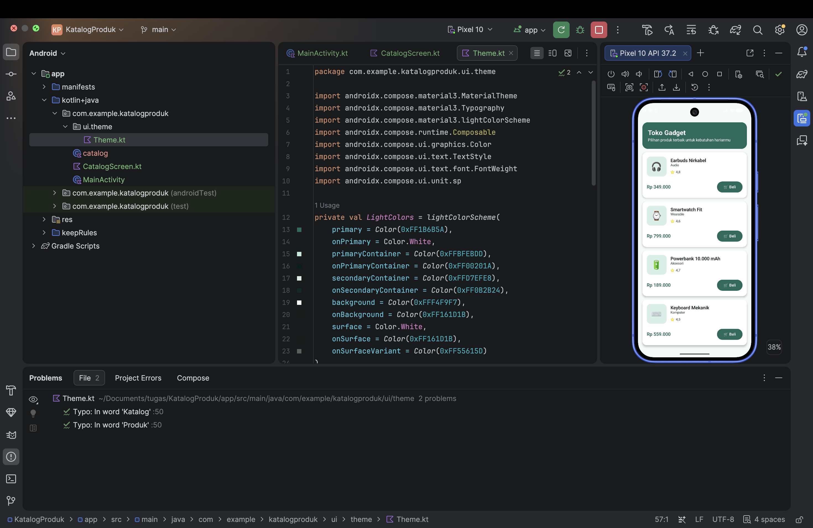
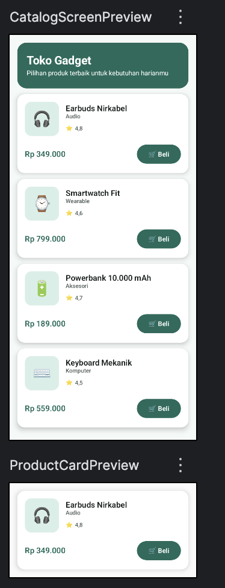

# Katalog Produk Sederhana (Compose Static UI Challenge)

Tugas Pertemuan 3 - Pemrograman Bergerak
NIM: 0102523033 | Nama: **M Ikmal**
Tema (digit terakhir NIM = 3): **Katalog produk sederhana**

## Tujuan Aplikasi
Menampilkan satu layar katalog produk gadget berbasis Jetpack Compose dan Material 3. Layar bersifat statis (belum ada state atau interaksi kompleks).

## Stack
Kotlin + Jetpack Compose + Material 3 (tanpa XML layout).

## Cara Menjalankan
1. Buka project di Android Studio.
2. Tunggu Gradle sync selesai.
3. Pilih emulator atau perangkat Android, lalu klik **Run**.
4. Untuk melihat tampilan tanpa menjalankan app, buka `CatalogScreen.kt` dan gunakan panel **Preview** (`CatalogScreenPreview`).

## Struktur Composable Utama
```
CatalogScreen
├── CatalogHeader        (judul + subjudul, Column)
├── ProductCard (x4)     (Card, Row, Column, Button, Icon)
│   └── ProductImage     (Box dengan emoji sebagai gambar produk)
└── InfoFooter           (Box + Text)
```

## Penggunaan Konsep
- **Layout:** Column, Row, Box
- **Komponen Material 3:** Text, Card, Button, Icon, Scaffold
- **Modifier:** fillMaxWidth, padding, size, clip, background
- **MaterialTheme:** warna dan typography di `Theme.kt`
- **Preview:** `CatalogScreenPreview` dan `ProductCardPreview`

## Screenshot




## Deklarasi AI
AI generatif digunakan sebagai alat bantu. Lihat bagian Deklarasi di PDF.
